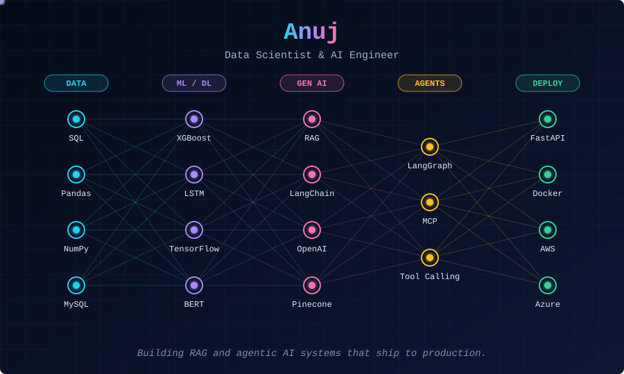
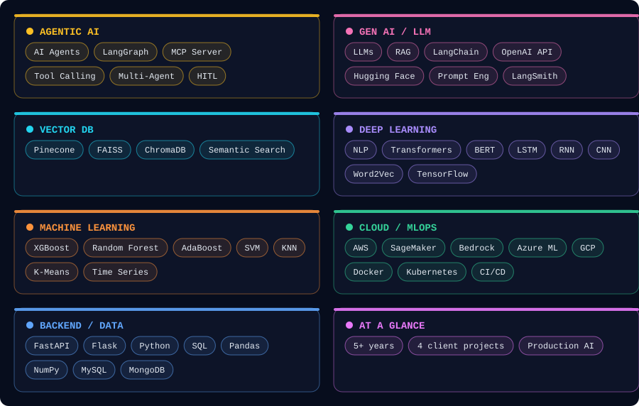

 

## 👋 About me

- 🧠 **Data Scientist & AI Engineer** with **5+ years** building end-to-end Machine Learning, Deep Learning and Generative AI solutions for real business problems
- 🤖 I specialize in **RAG applications** and **agentic workflows**: multi-agent systems with LangGraph, MCP servers, tool calling and human-in-the-loop approvals
- 🏢 At **Capgemini** since May 2021 as Data Scientist & AI/ML Engineer
- 🚀 I ship models and agents as **FastAPI services** on **AWS and Azure** with Docker, Kubernetes and CI/CD
- 🛡️ I care about reliability: guardrails, role-based access, grounded prompts to cut hallucinations, and LLM evaluation with LangSmith
- 📈 Classical ML too: demand forecasting, NLP sentiment models and time-series work
- 🎓 B.Tech in Computer Science, Sharda University (2018 – 2022)
- 💬 Ask me about: **RAG, LangGraph agents, MCP servers, forecasting, deploying ML**

## 🧠 Skills

## 🚀 Featured projects

> Built for enterprise clients, so the source code is private. Each case study below shows the problem, my solution and the outcome.

| Project                                        | Focus                            | Key stack                                           |
| ---------------------------------------------- | -------------------------------- | --------------------------------------------------- |
| 🤖 **HR Policy & Employee Support Chatbot**    | Agentic AI, multi-agent workflow | LangGraph · MCP Server · RAG · Pinecone · FastAPI   |
| 💬 **Enterprise RAG Customer Support Chatbot** | RAG, semantic search             | LangChain · OpenAI API · Pinecone · LangSmith · AWS |
| 💭 **Customer Feedback Sentiment Analysis**    | NLP & deep learning              | LSTM · TensorFlow · Word2Vec · Azure ML · AKS       |
| 💊 **Medicine Demand Forecasting**             | ML & time series                 | XGBoost · Random Forest · AdaBoost · AWS SageMaker  |

<b>🤖 HR Policy & Employee Support Chatbot (Agentic AI)</b>

**Problem:** HR teams spent much of their time answering repetitive questions on leave, payroll, benefits and policy. Information was spread across portals, documents and databases, and a basic chatbot could not check records or raise requests.

**Solution**

- Designed a stateful multi-agent workflow in **LangGraph** with agents for intent classification, policy retrieval, record lookup, request handling and response generation
- Built an **MCP server** giving agents secure, role-based access to HR databases, leave systems and internal APIs through tool calling
- Added **RAG with Pinecone** so the bot answers policy and onboarding questions from HR documents
- Used **checkpointed state** so conversations keep context and recover from failures
- Added **human-in-the-loop** approval for sensitive actions such as leave approvals and grievance escalations
- Applied guardrails so employees see only their own data; logged requests and audits in MySQL
- Served via **FastAPI**, traced with **LangSmith**, deployed on AWS with Docker and CI/CD

**Impact:** less HR workload, faster self-service answers for employees, safer handling of sensitive data, and consistent multi-turn conversations.

<b>💬 Enterprise RAG-Based Customer Support Chatbot</b>

**Problem:** Support staff answered the same FAQs repeatedly, answers were scattered across documents, and a plain LLM hallucinated on company-specific questions.

**Solution**

- Built a **RAG pipeline with LangChain** that grounds every answer in the knowledge base
- Created embeddings with the OpenAI API and indexed them in **Pinecone** with metadata
- Implemented **semantic search** with top-k retrieval, similarity thresholding and metadata filtering, and tuned top-k for relevance, completeness and latency
- Engineered prompts that restrict the LLM to retrieved context and give a safe fallback when no answer exists
- Stored chat history and session memory in MySQL for multi-turn conversations
- Exposed through FastAPI, evaluated with RAG metrics and LangSmith, deployed on AWS (EC2, S3, Bedrock)

**Impact:** automated repetitive FAQs, better answer relevance, fewer hallucinations, and knowledge updates through re-indexing only, with no retraining.

<b>💭 Customer Feedback Sentiment Analysis (NLP & Deep Learning)</b>

**Problem:** An e-commerce team could not manually keep up with thousands of reviews, so recurring complaints and sentiment shifts went unnoticed.

**Solution**

- Cleaned feedback data from MySQL with Python, Pandas and SQL
- Built NLP preprocessing (tokenization, stopwords, padded sequences) and a **TF-IDF + logistic regression baseline**
- Trained **RNN and LSTM** models in TensorFlow with **Word2Vec** embeddings and picked the LSTM for long-range context
- Tuned hyperparameters and evaluated with precision, recall, F1 and a confusion matrix
- Built dashboards for sentiment distribution, word clouds and trends over time
- Deployed with FastAPI, Docker and **Azure ML, Blob Storage, ACR and AKS** using CI/CD

**Impact:** automated feedback classification, surfaced top recurring complaints, clear trend dashboards, and real-time scoring through a scalable API.

<b>💊 Medicine Demand Forecasting (ML & Time Series)</b>

**Problem:** A pharma company planned demand for hundreds of SKUs with spreadsheets, missing seasonal spikes and regional differences, which caused stockouts and overstock.

**Solution**

- Prepared historical sales data from MySQL with Python, Pandas and SQL
- Engineered lag features, rolling averages, seasonality flags and regional trends
- Used time-series forecasting as a benchmark, then compared **XGBoost, Random Forest and AdaBoost** and combined them as an ensemble
- Used **time-based validation** with RMSE, MAPE and MAE to avoid data leakage
- Built FastAPI endpoints with scheduled retraining and a filterable view by region and product
- Deployed with Docker on AWS (EC2, S3, SageMaker) using CI/CD

**Impact:** better forecast accuracy for planning, fewer stockouts in high-demand periods, less overstock of slow movers, and forecasts kept current by automated retraining.

## 📊 GitHub stats

## 🎮 Arcade boards

Just for fun, drawn on sample data.

### 🚀 Galaga

### 👻 Pac-Man

---

⭐ If something here helped you, drop a star.

