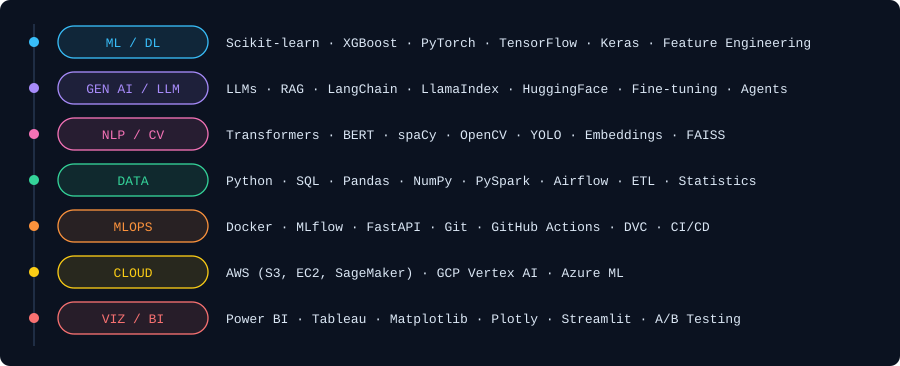

 

## 👋 About me
- 🎓 <<Degree / college / year>>
- 🔭 Building: **<<current project, e.g. RAG assistant over company docs>>**
- 💼 <<X years / internships>> experience in <<domains from resume>>
- 🌱 Learning: LLM fine-tuning, agents, MLOps
- 🏆 <<Hackathon / Kaggle rank / certification>>

## 🧠 Skills

## 🚀 Featured projects
| Project | What it does | Stack | Result |
|---|---|---|---|
| [**Multi-LLM RAG App**](https://github.com/anuj931270/<<repo>>) | Upload PDF/CSV/HTML/DOCX and compare answers from 3 LLMs | Streamlit · sentence-transformers · Groq · Gemini · OpenRouter | <<e.g. answers grounded in your docs>> |
| [**<<Project 2>>**](#) | <<problem it solves>> | <<tools>> | <<metric, e.g. 92% F1>> |
| [**<<Project 3>>**](#) | <<problem it solves>> | <<tools>> | <<metric>> |
| [**<<Project 4>>**](#) | <<problem it solves>> | <<tools>> | <<metric>> |

## 📊 GitHub stats

## 🐍 Contribution snake

<picture>
  <source media="(prefers-color-scheme: dark)" srcset="https://raw.githubusercontent.com/anuj931270/anuj931270/output/github-snake-dark.svg"/>
  
</picture>

---

⭐ If something here helped you, drop a star.

